# NavEasy

**Can I live here independently?** NavEasy scores homes, buildings, streets and neighborhoods in Houston and
Los Angeles for four needs (wheelchair, blind or low vision, deaf or hard of hearing, older adults or low stamina),
plans furniture so a person can move through their home alone, and finds a matching neighborhood when they move cities.

Built at **HackPrinceton Fall 2026** (Nov 13-15) for CoStar's **"Inside and Out: AI for the Built World"** track, on
CoStar building data, Matterport 3D scans and Vexcel aerial imagery, plus OpenStreetMap and Valhalla routing.

[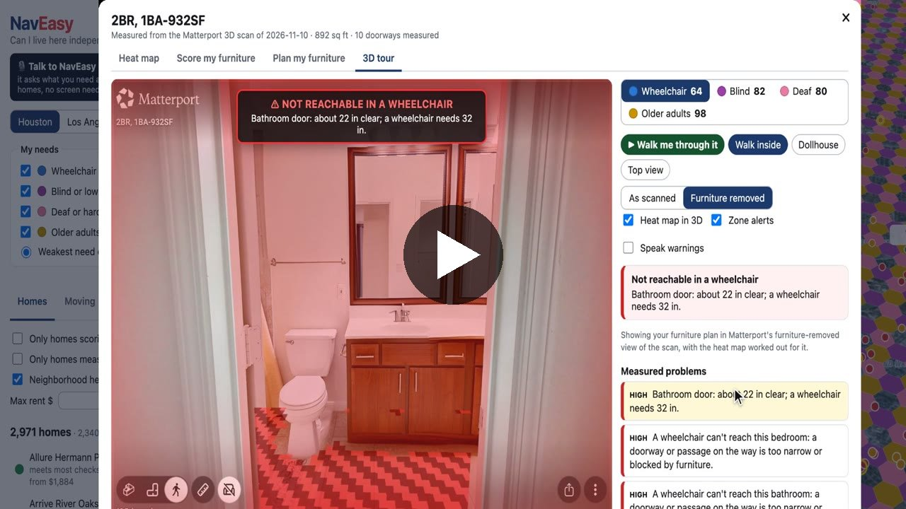](https://youtu.be/vtk44zTPlhU)

**[Watch the 2-minute demo](https://youtu.be/vtk44zTPlhU)** · **[Live site: naveasy.us](https://naveasy.us)** (served from
the team's machine, so it can be offline) · [Technical design](docs/TECHNICAL_DESIGN.md) · [API contract](docs/API_CONTRACT.md)

The core idea: we measure the inside of every scanned home automatically (doorway widths, thresholds, turning room,
sightlines, walking distances) from Matterport's wall graph and 3D mesh, then connect it to the building (elevator or
walk-up) and to accessible routes to everyday places. Every number shows its evidence, and nothing is called
"accessible": NavEasy says "meets our wheelchair checks" and lists what it could not check.

## Contents

- [The problem](#the-problem)
- [What NavEasy does](#what-naveasy-does)
- [A tour in screenshots](#a-tour-in-screenshots)
- [How it works](#how-it-works)
- [Numbers](#numbers)
- [Tech stack](#tech-stack)
- [Repo layout](#repo-layout)
- [Quick start](#quick-start)
- [API](#api)
- [Accuracy, limits and ethics](#accuracy-limits-and-ethics)
- [Built at HackPrinceton](#built-at-hackprinceton)
- [Project summary](#project-summary)
- [Feature status in full](#feature-status-in-full)
- [Data and keys: never commit them](#data-and-keys-never-commit-them)

## The problem

About one in four US adults has a disability (CDC). A home listing shows the rent and the number of bedrooms. It does
not say whether a wheelchair fits through the bathroom door, whether you would see a visitor or a flashing alarm from
the sofa, or how far the bathroom is from the bed at night. Most people find out after they have moved in.

NavEasy is for the person with the need and for the family members, occupational therapists and case managers who
search with them. A second audience is CoStar's own customers: property managers and brokers who want to market
accessible units honestly, and cities that want to see where accessible housing and accessible streets don't meet.

## What NavEasy does

It answers one question at six levels, for one need or several at once (with several, the weakest need decides, or the
average if you prefer):

| Level | What you get |
| --- | --- |
| Neighborhood | A heat map of how quickly and safely you reach a hospital, clinic, pharmacy, grocery, bus or rail stop, restaurants, school and park, by your own travel mode |
| Route | The way from a home to a place, each stretch colored for your need, with the hard spots pinned and an aerial photo of each |
| Building | A score from elevator or walk-up, stories, age, listing evidence and the best unit measured inside, plus Vexcel photos from four sides and a drone 3D model where one exists |
| Apartment | A 5 cm floor-plan heat map per need: doorway widths, reachable floor, turning circles, routes, sightlines, distances, built-ins and their heights, with a problem list and a 3D tour that turns red where you can't go |
| Furniture | Your current layout scored, or your own furniture planned into a new home around your needs, with a reason for every piece |
| Moving | Neighborhoods in the other city where everyday places are as close for you as they are now, with the best homes in each |

**The four needs** (the neighborhood map shades each in its own hue, never red or green, checked for color-blind separation):

| Need | Inside the home NavEasy measures | Map hue |
| --- | --- | --- |
| Wheelchair | Door clear width (32 in), walkways (36 in), 60 in turning circles in bedroom, bathroom and kitchen, 30 x 48 in beside the bed, thresholds, counter heights (34 in) | Blue |
| Blind or low vision | Routes from the front door to bed, bathroom and kitchen, their turns, anything within 30 cm of them, steps | Plum |
| Deaf or hard of hearing | What is in view from the main seat and from the kitchen, and whether the front door is | Pink |
| Older adults or low stamina | Distance from the bed (the night walk to the bathroom), stairs, places to sit on the way in | Gold |

## A tour in screenshots

| | |
| --- | --- |
| 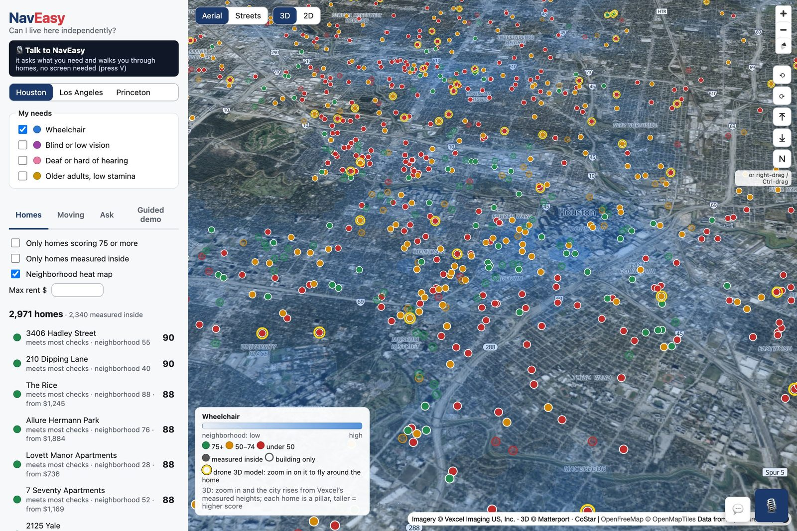 **Houston, wheelchair selected.** The darker the blue, the better the neighborhood; every dot is a building, green 75+, orange 50-74, red under 50. | 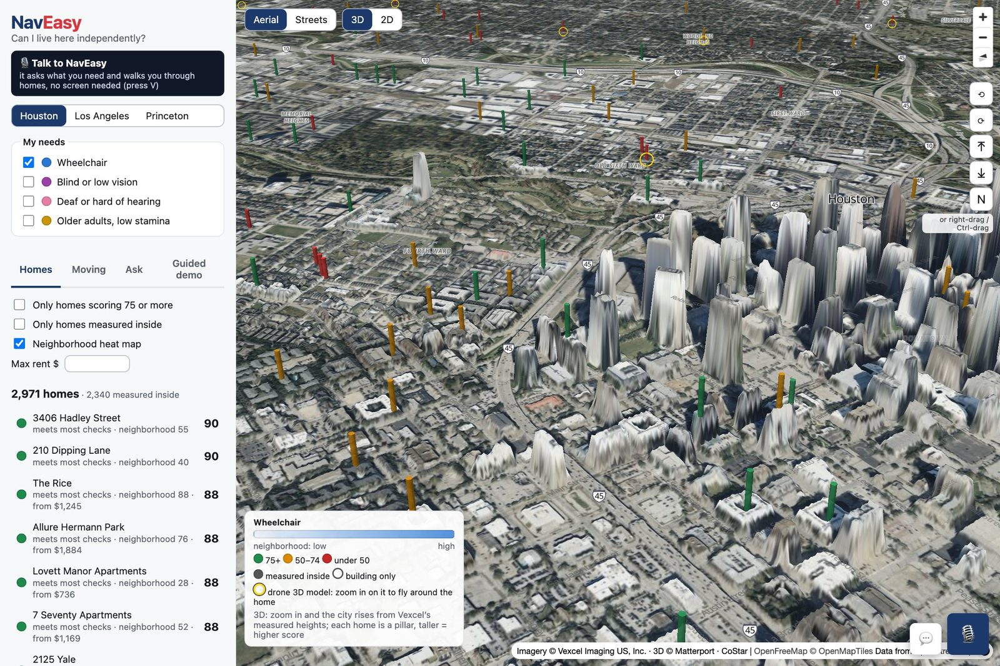 **The city in 3D** from Vexcel's measured surface heights; each home is a pillar, taller is a higher score. |
| 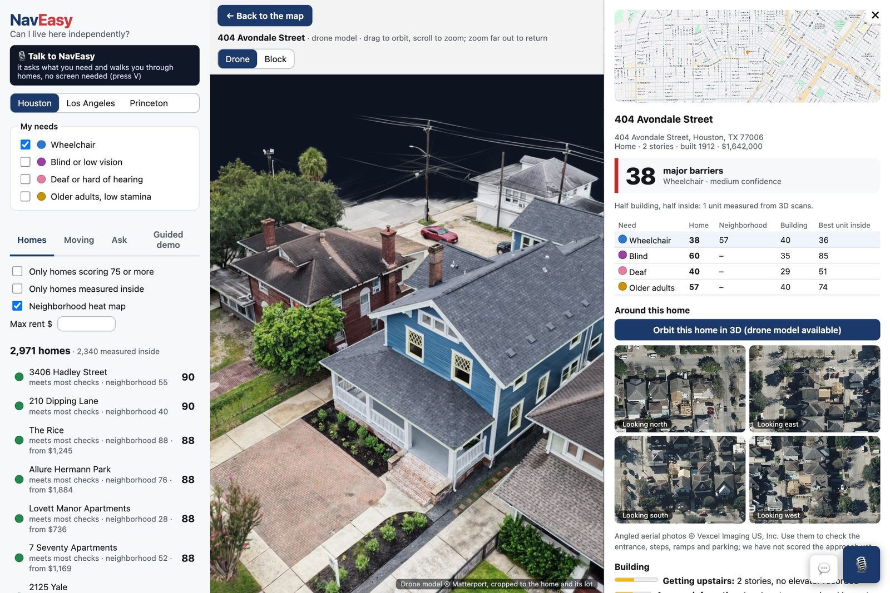 **Drone 3D model.** Homes with a yellow ring have a Matterport aerial Gaussian splat; zoom past 18 and the map hands over to it. | 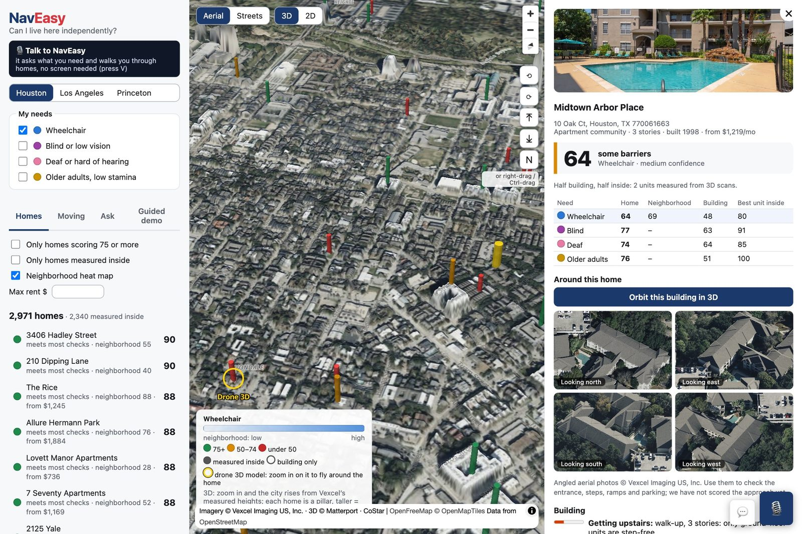 **A building:** its score per need (home, neighborhood, building, best unit inside) and Vexcel angled photos from four sides. |
| 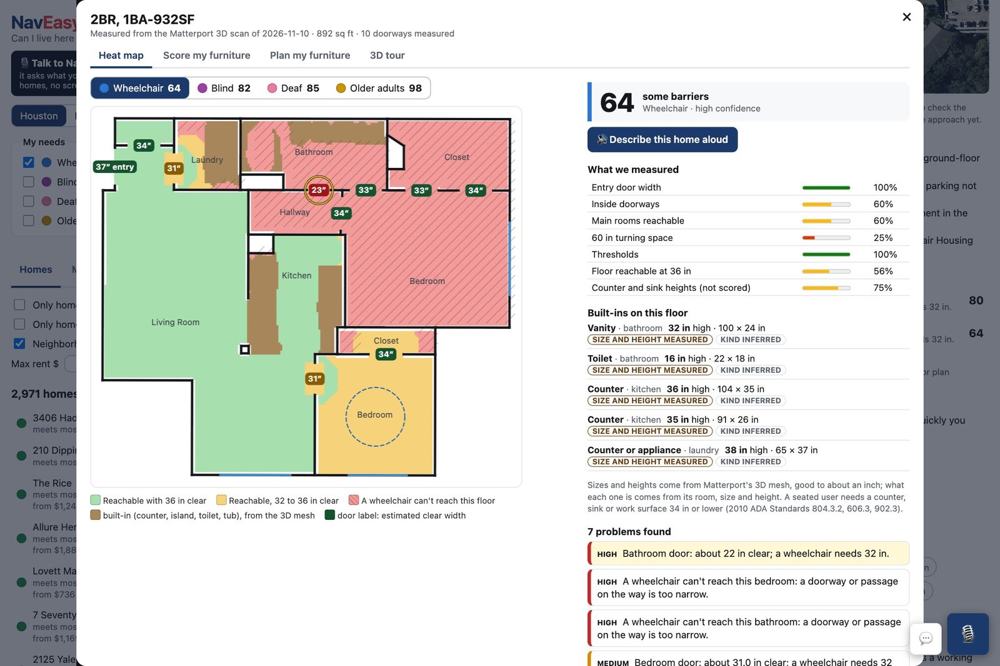 **Inside, for a wheelchair:** green reachable at 36 in, yellow at 32-36 in, hatched red unreachable. The bathroom door is about 22 in. | 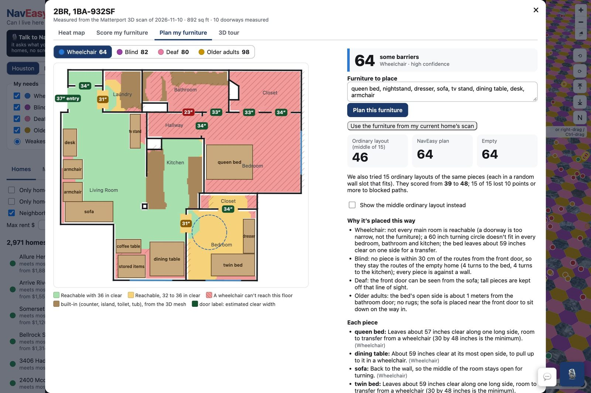 **Plan my furniture:** the furniture from the user's current home's scan, placed for all four needs. NavEasy plan 64, the same as the empty home; an ordinary layout 46. |
| 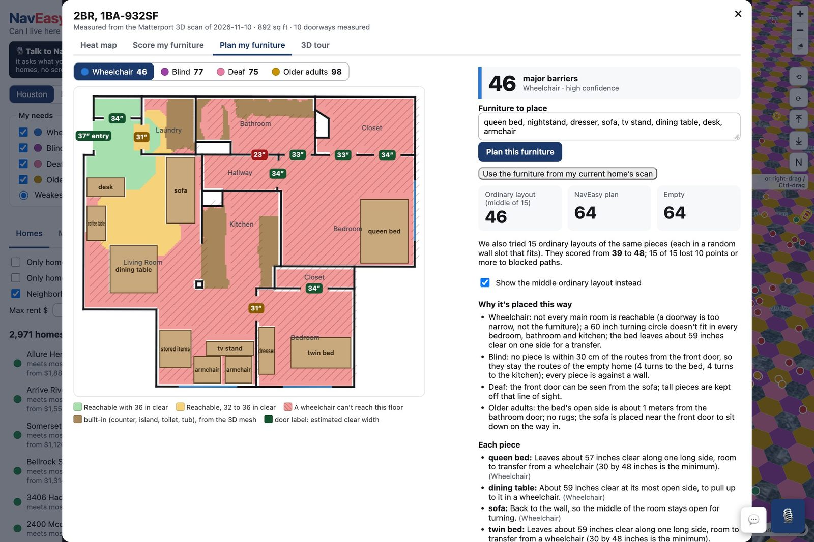 **The same pieces placed the ordinary way:** all 15 random legal layouts lost 10 points or more to blocked paths. | 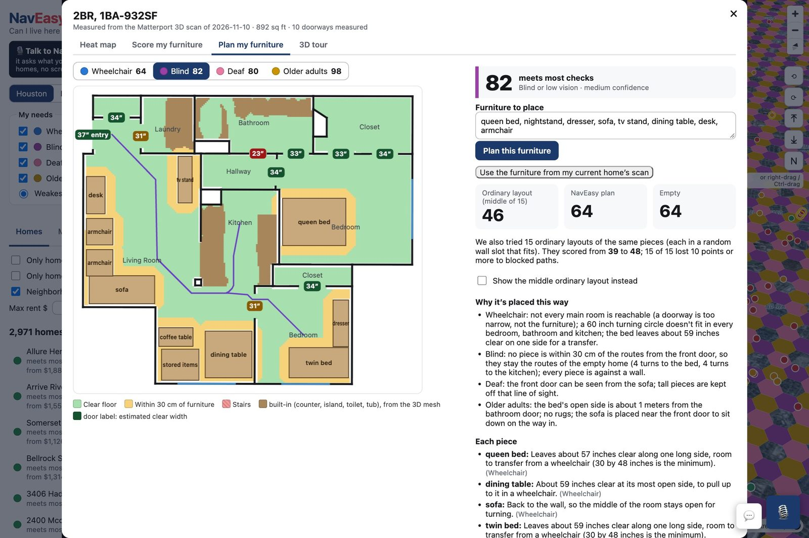 **Blind or low vision:** the routes from the front door, every piece against a wall and at least 30 cm off them. |
| 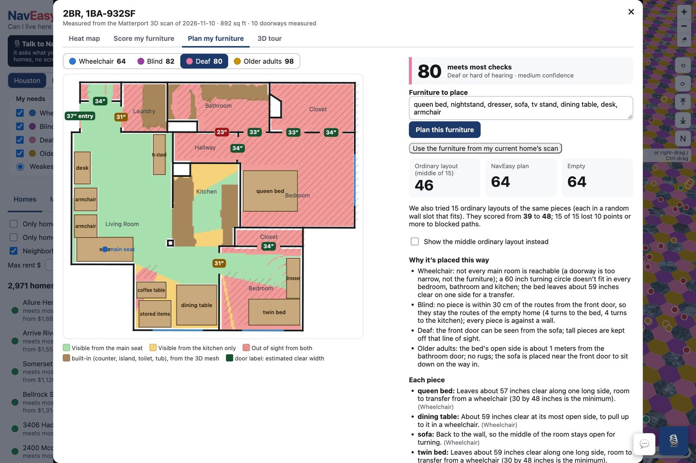 **Deaf or hard of hearing:** green is in view of the main seat, yellow of the kitchen only, red neither; the sofa keeps the front door in view. | 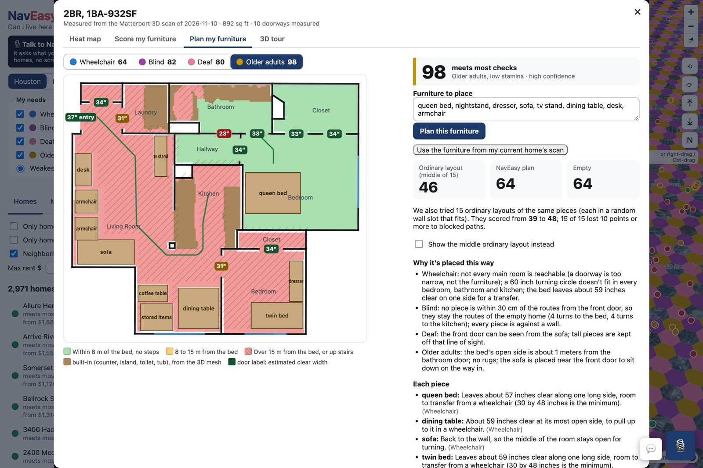 **Older adults:** distance from the bed; the bed's open side is about 1 m from the bathroom door. |
| 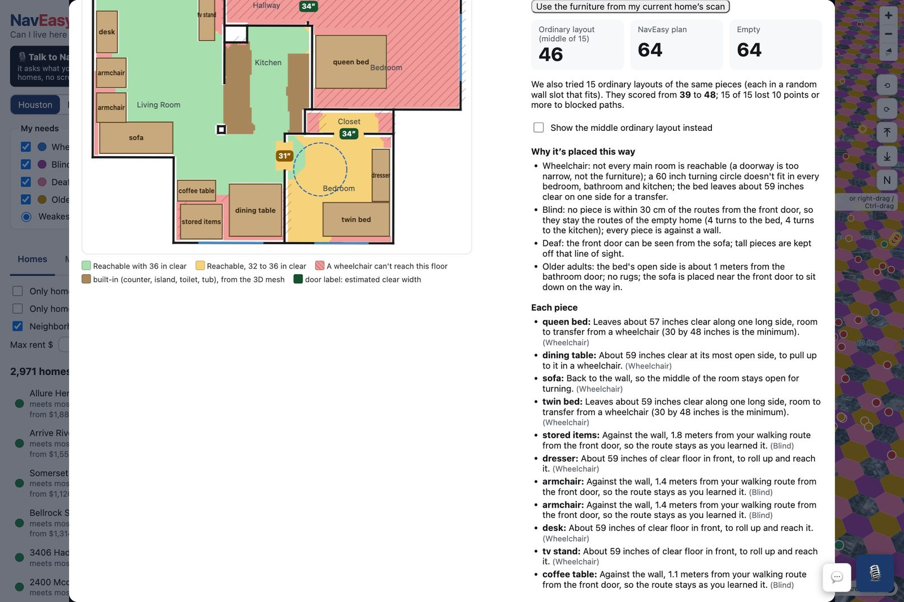 **Every piece says why** it goes where it does and which need it serves. | 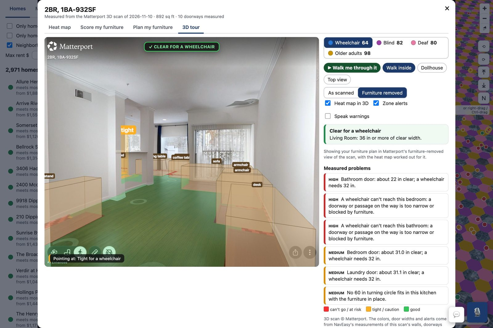 **The Matterport 3D tour** in its furniture-removed view, with the planned furniture and the heat map drawn on the floor. |
| 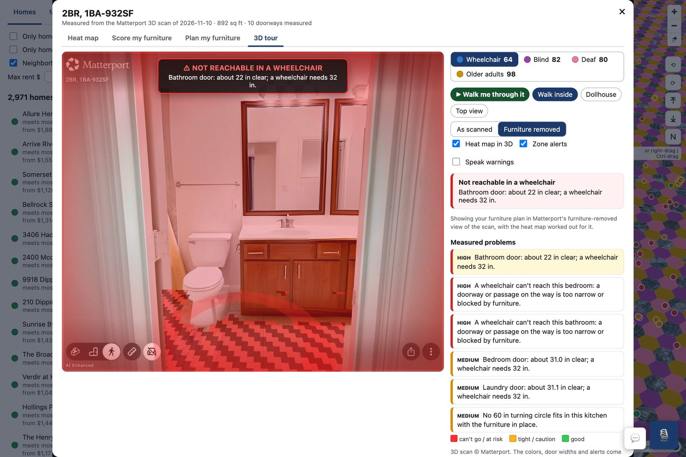 **At a problem the screen turns red**, with the reason: "Bathroom door about 22 in clear; a wheelchair needs 32 in." | 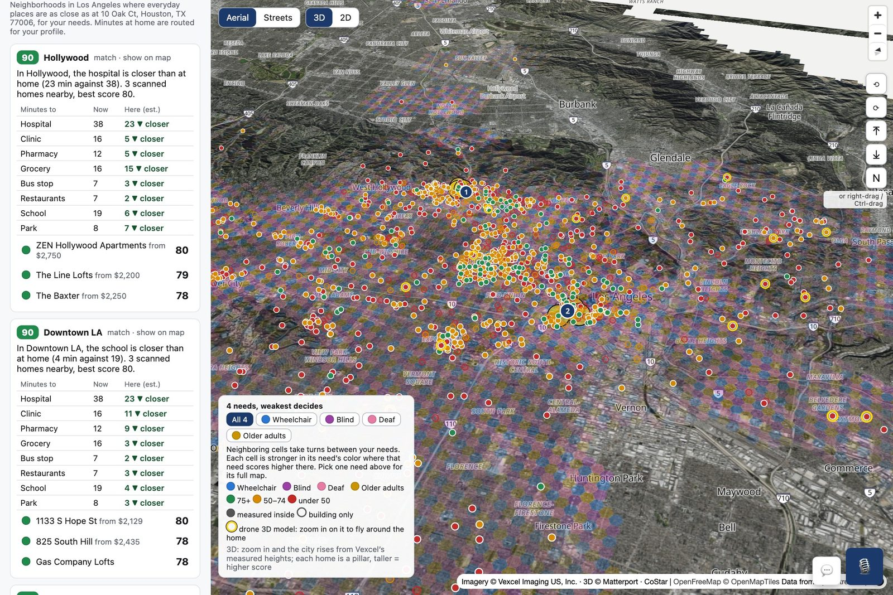 **Moving cities:** a Houston address matched to Hollywood, Downtown LA and Brentwood, where the pharmacy, clinic and bus stop are closer than now. |

## How it works

### Data sources and how they join

| Source | What NavEasy uses |
| --- | --- |
| CoStar commercial properties (kit) | 3,339 properties, 2,765 of them apartment communities: location, stories, walk-up flag, elevators, construction year, parking, photos, links to Matterport scans |
| CoStar apartment and residential listings | Rents and units available per floor plan (1,747 communities); 2,120 Homes.com listings with beds, baths, elevator and accessibility flags, and feature text |
| Matterport Model API (GraphQL) | Rooms, floors and the wall graph in meters (walls, doorways, openings, windows, thresholds), scan positions, panoramas and their furniture-removed view, 2D floor plans, the textured 3D mesh, the aerial Gaussian splat |
| Matterport Showcase SDK | The 3D tour in the browser, with NavEasy's measurements drawn inside it |
| Vexcel API | Aerial tiles for the base map, surface heights (3D terrain and route slope), angled photos from four directions, crosswalks seen from the air |
| OpenStreetMap (Overpass) | Places, sidewalks, crossings, curbs, signals, tactile paving, benches |
| Valhalla | Walking routes and walking times by profile (wheelchair, blind, standard, slow) |
| GTFS | Houston METRO (8,803 stops) and LA Metro (12,354 stops) |

CoStar properties and listings link to Matterport models through `MatterportModelId`; everything joins to Vexcel,
OpenStreetMap and Valhalla by latitude and longitude. A Matterport model links to its furniture-removed view through
`view(type: "matterport.model.defurnished")`.

### Architecture

Everything slow (API calls, geometry, routing, furniture extraction) runs ahead of time in Python jobs and lands as
JSON in `data/`. The API loads it in memory and calls live services only for a new route, a furnishing plan, a
relocation or the agent.

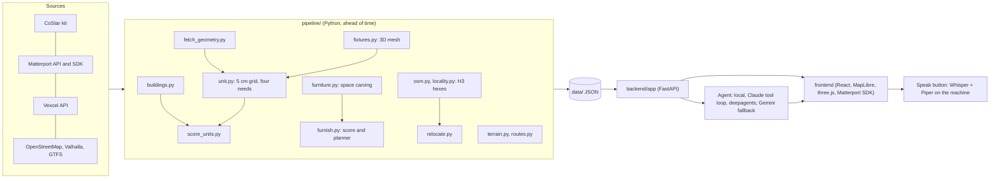

### 1. Neighborhood heat map

The city is covered with H3 hexagons (resolution 9, about 0.1 km2). Each cell gets a 0-100 score per need from how
fast a person with that need reaches each kind of everyday place, plus how walkable the streets are for them:

| Place | Good within | Zero at | Weight |
| --- | --- | --- | --- |
| Hospital or urgent care | 15 min | 45 min | 0.20 |
| Clinic or doctor | 10 min | 30 min | 0.15 |
| Pharmacy | 10 min | 30 min | 0.15 |
| Grocery | 10 min | 30 min | 0.15 |
| Bus or rail stop | 5 min | 15 min | 0.15 |
| Restaurants and cafes (the 3rd nearest, for choice) | 10 min | 30 min | 0.08 |
| School | 15 min | 40 min | 0.07 |
| Park | 10 min | 30 min | 0.05 |

`score = 100 x (0.7 x weighted place scores + 0.3 x street score)`, where each place scores
`clamp((zero - minutes) / (zero - good), 0, 1)` and the street score covers sidewalk coverage, lowered curbs,
crosswalks, signals, audible signals and tactile paving, slope, and benches, weighted by need. Travel times are by
profile: Valhalla's wheelchair costing for wheelchair, its blind costing for blind, standard walking for deaf, and
walking at 3 km/h for older adults. Midtown Houston has routed walking times; elsewhere times are estimated from
distance and say so. Cells without a scan nearby stay grey: grey means "no data", never
"inaccessible". 18,788 cells in Houston, 6,500 in LA.

### 2. Routes

From a home to the nearest place of a kind (or any address), Valhalla gives the route for the profile; NavEasy then
colors each stretch from OpenStreetMap (sidewalk or road, crossings, lowered curbs, signals, benches) and from slope
measured on Vexcel surface heights (2 m grid, roofs and treetops pressed down to nearby ground, slope over 30 m
windows). Each hard spot gets a pin with a Vexcel aerial photo and a crosswalk check. Unmapped sidewalks are grey, not red.

### 3. Building score

Half building evidence (vertical access: elevator, walk-up, stories and unit floor; listing evidence; age, with
buildings before 1991 predating the Fair Housing design rules), half the best unit measured inside when one exists.
Building markers keep green / orange / red bands (75+, 50-74, under 50), and the "Only homes scoring 75 or more" filter
matches the green band.

### 4. The apartment engine (`pipeline/unit.py`)

1. **Geometry.** Matterport's wall graph per floor: walls with thickness, doorways, openings and windows (width, height,
   threshold), rooms with type and outline, in meters.
2. **Rasterize at 5 cm.** Walls become blocked cells at their real thickness; doorways cut gaps; windows are recorded
   for daylight.
3. **Built-ins** from the 3D mesh (section 5) and **furniture** from the scan (section 6) or a plan (section 7).
4. **Clearance.** A distance transform gives every free cell its distance to the nearest obstacle; twice that is the
   local clear width.
5. **Per-need layers, checks, problems and a score.**

| Check | Threshold | Rule (2010 ADA Standards as a benchmark) |
| --- | --- | --- |
| Door clear width | 32 in (0.815 m); scan width minus 5 cm, because scans measure the frame opening | 404.2.3 |
| Walkway | 36 in (0.915 m) | 403.5.1 |
| Turning circle | 60 in (1.525 m) in bedroom, bathroom and kitchen | 304.3.1 |
| Clear floor beside bed, toilet, sink | 30 x 48 in (0.76 x 1.22 m) | 305.3 |
| Threshold | flagged from 3 cm (readings are noisy by about 2 cm) | 303 |
| Counter, sink, work surface | 34 in or lower for a seated user (reported, not weighted) | 804.3.2, 606.3, 902.3 |

| Need | Layer |
| --- | --- |
| Wheelchair | Obstacles inflated by half the chair width, flood fill from the entry: green reachable at 36 in, yellow at 32-36 in or behind a tight door, red not reachable. Turning circles drawn where they fit. If the entry door fails, nothing inside counts as reachable for the score; the map still shows what a wider door would open up |
| Blind | Shortest paths from the entry to bed, bathroom and kitchen; turns over 30 degrees counted; anything within 30 cm of a path flagged; stairs |
| Deaf | 720 rays cast from the main seat (the sofa, or the living room's center) and from the kitchen: what is visible from each, and whether the entry door is |
| Older adults | Walking distance from the bed (green within 8 m, yellow 8-15 m, red farther or up stairs), the night path from the bed to the bathroom, entry to kitchen, stairs |

Each need's score is a weighted sum of its checks (`A = 100 x sum of weight x pass`), and every score carries a
confidence. Across 29,000 scanned doorways the widths cluster at 24, 28, 30, 32 and 36 in, the nominal door sizes,
which is how we know scans measure frame openings. A door within 5.5 cm of the limit lets the chair through but
everything behind it shows as caution.

### 5. Built-ins from the 3D mesh (`pipeline/fixtures.py`)

The wall graph has no counters, so without help a route to the kitchen can run straight across the island.
Matterport's textured mesh (a 50k-triangle OBJ, about 1 MB) has them: in a kitchen, bathroom, laundry, pantry or
utility room, any level surface 30 cm to 1.3 m above the floor is a counter, island, vanity, toilet or tub rim. Each is
measured as its own item (width and depth from its minimum rotated rectangle, height of its top above the floor next to
it). Level surfaces in other rooms (beds, sofas, tables) are left out: they belong to whoever lived there. Stairs come
from the mesh too.

### 6. Furniture finder (`pipeline/furniture.py`)

Space carving on the floor plane, using the furnished panoramas and Matterport's furniture-removed view of the same
scan positions: for every scan position, compare each pixel of the two cube maps; a pixel that looks down at the floor
and did not change shows free floor. A floor cell in view of at least one scan position that was never seen free is
under something movable. Connected groups are furniture footprints; their edges are pulled in 10 cm so footprint error
can't close a real path. `pipeline/furnished_scan.py` finds which scans are furnished with a cheap two-panorama check.
Labels are confirmed by hand for the hero homes (the lived-in 7833 Narcissus St has 11 pieces).

### 7. Furnishing score and planner (`pipeline/furnish.py`)

Two modes, both judged by the apartment engine:

- **Score my furniture:** the current layout against the same home empty ("the furniture costs N points"), and the
  single changes that gain the most (move, rotate, remove, replace), each with its gain.
- **Plan my furniture:** a typed list, or the furniture from the user's current home's scan, placed into a new home.
  Candidates are wall slots every 10 cm with the piece's back to the wall, plus free spots for tables; the largest
  pieces go first, each placement is rechecked with a flood fill on the inflated grid.

Rules per need (several needs at once means all their rules):

| Need | What the planner keeps |
| --- | --- |
| Wheelchair | 30 x 48 in beside the bed for a transfer, 30 in in front of what you use, the turning circles, 36 in ways through |
| Blind | Every piece against a wall and at least 30 cm off the routes from the front door, so the routes stay as learned (a coffee table that can only sit in a route goes on the won't-fit list) |
| Deaf | The sofa in view of the front door, with tall pieces off that line of sight |
| Older adults | The shortest night walk from the bed to the bathroom, a seat near the entry, no rugs |

The baseline is fair: 15 random legal layouts of the same pieces, reported as a range, not one chosen bad layout.
Every placed piece says why it is there and which need it serves (`why`, `needs`, `caution`), and the plan can be
changed by voice ("what if the sofa goes against the left wall"; "undo").

Examples from the real data: the 2BR at Midtown Arbor Place with the furniture from 7833 Narcissus St, planned for all
four needs, scores 64, the same as the empty home; an ordinary layout scores 46, and all 15 lost 10 points or more to
blocked paths. Drewery Place's 2BR planned for a wheelchair scores 91; 9 of 15 ordinary layouts block a path and drop
to about 49.

### 8. Inside the Matterport 3D tour (`frontend/src/components/tourOverlay.ts`, `frontend/src/zones.ts`)

The embed SDK can't add objects to Matterport's own scene, so NavEasy draws a transparent three.js layer over the
tour that copies Matterport's camera on every pose update (about 22 a second). The walls from the wall graph are drawn
invisibly into the depth buffer first, so anything behind a wall stays hidden while doorways stay open. On the floor:
the chosen need's heat map, door gates with their widths, turning circles, main paths, the deaf "main seat", furniture
(outlined if found in the scan, solid if planned) and pulsing problem rings.

Walking inside, the screen edges pulse red where that need can't go or is at risk and amber where it's tight, with
the reason on screen; pointing at the floor previews a spot before you step there; blind mode speaks each warning.
Problem pins fly the camera to each problem. A furniture plan is shown in Matterport's furniture-removed view.
"Walk me through it" plays a tour from just inside the front door room by room, the camera moving as each sentence is
spoken (`GET /units/{id}/walk`).

### 9. Outside: aerial 3D map, angled photos, drone models

Vexcel aerial tiles are the base map and Vexcel surface heights become 3D terrain past zoom 15 (both proxied and
cached; the key stays on the server). Every building can be orbited in 3D from surface heights and the aerial photo,
and shows Vexcel's angled photos from four directions. 230 buildings have a Matterport aerial Gaussian splat, cropped
to the home and its lot (`pipeline/splat.py`); on the map they carry a yellow ring, and zooming past 18 near one hands
the map over to its drone model, starting at the map's tilt (Escape or "Back to the map" returns).

### 10. Moving cities (`pipeline/relocate.py`)

Any address in either city is geocoded (Nominatim) and measured live for the user's needs: minutes to each kind of
place. Candidate cells in the other city (or another neighborhood in the same one) are ranked so that only a slower
trip counts against a candidate; a closer pharmacy is never a penalty. With several needs, each place uses the
slowest need's minutes. The answer is the top neighborhoods, each with a plain reason, a "now vs there" table and its
three best homes. Example: 10 Oak Ct, Houston to LA returns Hollywood, Downtown LA and Brentwood, each match 90, where
the pharmacy, clinic and bus stop are all closer than at home.

### 11. Voice and agents (`backend/app/`)

One entry point, `POST /agent/chat`, three paths:

| Path | When | How |
| --- | --- | --- |
| Local (`dialogue.py`, `brain.py`) | Voice and the guided conversation | The agent leads: asks what help you need, then budget and area (or your current address), reads back three homes and asks for one, gives a broker's summary (rent, layout, what was measured inside, minutes to places, the main weakness, what to verify before signing), tours the home from the entry door, then places your own furniture and says where each piece goes from each room's doorway. Free speech is understood by a local open-source model through Ollama (`qwen2.5:7b`, about 4 s a turn), with keyword rules as the fallback |
| Claude tool loop (`agent.py`) | Typed questions | `claude-opus-5-5` with seven tools, about 12 s |
| Planned deepagents run (`deep.py`) | Typed multi-step home searches | LangChain deepagents 0.7: a planner with a to-do list and four subagents (building from CoStar, inside from Matterport, outside from Vexcel and routes, and a checker that re-runs failing findings and marks the rest "needs a site visit"), about 85 s live; the three demo requests are cached (`scripts/cache_deep_runs.py`) |

When Claude has no credit the same agents run on Gemini (`gemini-3.8-flash`; `NAVEASY_LLM=claude` or `gemini` forces
one); with neither, typed questions are answered locally. Guardrails: the agent never computes geometry or scores
itself, it calls the API for every number; every number in an answer is matched against the tool results; the chat
shows the plan, each subagent's task and every tool call live; answers say "meets our checks", never "accessible".
The agent also moves the app as it talks (`set_map_view`, `highlight_buildings`, `open_unit`, `show_route`,
`show_relocation`, `open_drone`, `tour_goto`, `set_filters`).

Speech is open source and runs on the machine: Whisper (`base.en`, faster-whisper) hears and Piper
(`en_US-lessac-medium`) speaks, about 1 s a turn. The speak button (press V) docks beside the chat; the map and panels
stay visible and move as it talks. The app also answers questions about what's on screen from a snapshot of what is
shown (`screen.py`), and describes a home aloud from the entry door: room sizes, window directions and sun from
Matterport's compass alignment, doorways and problems (`narrate.py`). Gemini Live is an optional voice
(`docs/VOICE.md`).

### 12. The building we were standing in (Princeton)

The HackPrinceton venue (Julis Romo Rabinowitz Building, scans `P3S6VUTP3qB` and `R1FX6EmdcDt`) opens as a public
building (city button "Princeton"): heat map per floor, door and corridor widths, stairs and a raised floor part found
in the 3D mesh, gaps too narrow to be doors set aside, the way from the entrance to the classroom, and the walk from
Princeton station or Lot 10 with slope from Vexcel heights. Ask by voice or chat: "how do I get to the classroom", "how
wide is the classroom door", "where are the stairs". Every number says whether a tape has checked it
(`docs/GROUND_TRUTH.md`, `ground_truth/princeton.json`); none has yet.

### 13. 3D-printed tactile table models (`scripts/print3d.py`, `docs/PRINT3D.md`)

Two homes printed as open-top boxes (walls, door gaps, window notches, built-ins, furniture) with four drop-in floor
mats each, one per need, so the table shows by touch what the app's heat map shows. The same code on every mat: solid
is good, raised stripes are caution, an open net is a problem, and a hole is where furniture stands. Raised marks per
need: turning rings and barrier bars (wheelchair), tactile guide ridges and warning domes (blind), eye posts at the
main seat and kitchen with a dashed sight line to the front door (deaf), the night-walk ridge (older adults).

| Playa Palms 1BR (wheelchair 44): box, then wheelchair, blind, deaf and older-adult mats |
| --- |
| 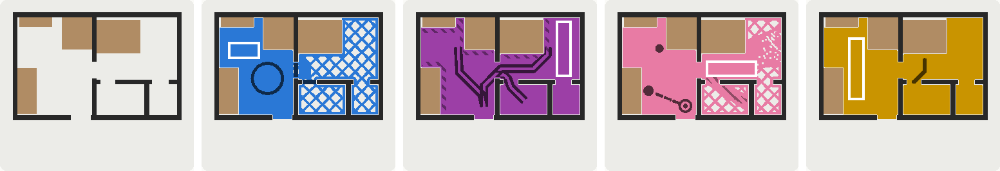 |
| **833 W 84th St 1BR (wheelchair 100)**, the same size and furniture |
| 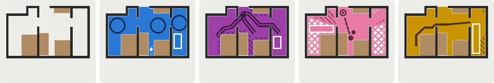 |

The quick set (two same-size LA one-bedrooms at 1:120) prints on 2 plates in about 1.6 h on a Bambu A1 mini; the demo
set (Narcissus and Drewery at 1:95) is 10 plates, about 8 h. Every STL is watertight, and every mat is checked to clear
walls and furniture by 0.5 mm. `scripts/print_time.py` estimates print times without a slicer.

## Numbers

| | |
| --- | --- |
| Buildings scored | 4,670 (2,765 apartment communities, 1,905 homes) in Houston and LA |
| Matterport scans indexed | 13,771; 6,551 with a wall graph measured inside; 7,220 shown with Matterport's own 2D plan and tour |
| Doorways measured | 71,065 in 6,551 scans |
| Neighborhood cells | 18,788 in Houston, 6,500 in LA |
| Transit stops | 8,803 (Houston METRO), 12,354 (LA Metro) |
| Drone 3D models | 230 buildings (198 Houston homes ringed on the map) |
| Furniture-removed views | 6,742 scans |
| Code | about 16,000 lines of Python and TypeScript; 74 tests (`python -m pytest tests`, about five seconds, no network) |
| Built | 53 commits, Nov 14-15, 2026 |

## Tech stack

| Layer | Tools |
| --- | --- |
| Pipeline | Python, numpy, scipy, shapely, h3, Pillow, tifffile; Matterport GraphQL, Vexcel REST, Overpass, Valhalla, Nominatim |
| API | FastAPI, uvicorn; data as JSON in memory |
| Web app | React 19, TypeScript, Vite, MapLibre GL 6 (3D terrain, extrusions), three.js (tour overlay), `@mkkellogg/gaussian-splats-3d` (drone models), Matterport Showcase SDK, h3-js |
| Agents | Anthropic API (`claude-opus-5-5`), LangChain deepagents 0.7, Gemini (fallback and Live voice), Ollama (`qwen2.5:7b`, local) |
| Speech | faster-whisper (`base.en`), Piper (`en_US-lessac-medium`), both local |
| 3D printing | manifold3d, trimesh |
| Hosting | The API serves the built web app on one port, shared through a Cloudflare tunnel (`scripts/serve_public.sh`) |

## Repo layout

| Path | What |
| --- | --- |
| `docs/TECHNICAL_DESIGN.md` | The full design: features, scoring formulas, data model, scope, and what the build changed |
| `docs/API_CONTRACT.md` | Shapes the frontend and backend agree on |
| `docs/VOICE.md`, `docs/GROUND_TRUTH.md`, `docs/PRINT3D.md` | Voice options, the venue tape-measure plan, the 3D-printed models |
| `pipeline/buildings.py` | CoStar kit to the building table and building scores |
| `pipeline/fetch_geometry.py` | Pulls and caches Matterport geometry for every scan |
| `pipeline/unit.py` | The apartment engine: wall graph to 5 cm grid to heat maps, checks and scores for four needs |
| `pipeline/score_units.py` | Scores every cached scan and folds the results into the buildings |
| `pipeline/osm.py`, `pipeline/locality.py` | OpenStreetMap cache and the hex heat map |
| `pipeline/routes.py` | Route A to B with stretch colors and hard spots |
| `pipeline/furniture.py`, `pipeline/furnish.py` | Furniture finder (furnished vs furniture-removed panoramas) and the furnishing scorer and planner |
| `pipeline/furnished_scan.py` | Finds which scans are furnished (cheap two-panorama check) |
| `pipeline/fixtures.py` | Built-ins (counters, islands, toilets, tubs) and stairs from Matterport's 3D mesh |
| `pipeline/floorplan.py` | One model's wall graph to the unit JSON and PNG the app reads |
| `pipeline/relocate.py` | Relocation match (between cities or within one) |
| `pipeline/terrain.py` | Vexcel surface heights as terrain tiles; ground height and slope along a route |
| `pipeline/splat.py` | Crops Matterport's aerial Gaussian splat to the home and its lot |
| `pipeline/venue.py` | The venue as a public building: entrances, corridors, doors, stairs, routes inside and out, tape-measure evidence |
| `backend/app/main.py` | FastAPI app: every endpoint, tile and image proxies, and the built web app |
| `backend/app/agent.py`, `deep.py`, `dialogue.py`, `brain.py` | The agent's router and Claude tool loop; the planned deepagents mode; the local, agent-led conversation; the local language model |
| `backend/app/speech.py`, `narrate.py`, `screen.py` | Local speech, spoken home descriptions, answers about what's on screen |
| `frontend/src/components/` | Map, building panel, unit view (heat map, score and plan tabs, 3D tour), relocation, chat, speak dock, drone and outside 3D |
| `scripts/print3d.py`, `scripts/print_time.py` | Table models for the 3D printer, and a print-time estimate |
| `scripts/serve_public.sh` | Keeps the app public through a Cloudflare tunnel, restarting the API or tunnel when either stops |
| `scripts/prewarm_3d.py`, `prefetch_splats.py`, `cache_deep_runs.py`, `make_mock.py` | Demo preparation: pre-load 3D tiles and drone models, cache the planned agent runs, mock data |
| `tests/` | Engine, scoring, furnishing, conversation, narration, venue and agent-mode tests |
| `ground_truth/` | The venue's tape-measure sheet |

## Quick start

```bash
python3 -m venv .venv && . .venv/bin/activate
pip install -r backend/requirements.txt
cp .env.example .env            # fill in your own keys (see the Team Access Kit); unzip the CoStar kit into costar-kit/
```

Build the data once (about 25 minutes, mostly downloads; every step caches and can be rerun):

```bash
python -m pipeline.buildings                 # building table
python -m pipeline.fetch_geometry all        # Matterport geometry, 3 workers
python -m pipeline.score_units               # unit scores + buildings_scored.json
python -m pipeline.osm pois houston && python -m pipeline.osm pois la && python -m pipeline.osm streets
# transit stops (optional): stops.txt from the Houston METRO feed (metro.resourcespace.com/pages/download.php?ref=4835&ext=zip)
# and LA Metro (gitlab.com/LACMTA/gtfs_bus, gtfs_rail) go in data/gtfs/houston_stops.txt and data/gtfs/la_stops.txt
python -m pipeline.locality houston --live && python -m pipeline.locality la
python -m pipeline.furniture fetch <model_id> && python -m pipeline.furniture find <model_id>   # per furnished hero home
python -m pipeline.fixtures <model_id>       # built-ins from the 3D mesh; score_units --meshes rescores homes with a cached mesh
```

Speech models (open source, run locally; needs `ffmpeg`). Whisper downloads itself on first use; fetch the Piper voice once:

```bash
mkdir -p data/speech && cd data/speech
B=https://huggingface.co/rhasspy/piper-voices/resolve/main/en/en_US/lessac/medium
curl -LO $B/en_US-lessac-medium.onnx && curl -LO $B/en_US-lessac-medium.onnx.json
```

The assistant's understanding uses a local model through Ollama: `ollama pull qwen2.5:7b` (4.7 GB). Set
`NAVEASY_LOCAL_LLM` to pick another model, or to `off` for keyword rules only.

Run it:

```bash
./run.sh                                     # API on :8000 and the web app on http://localhost:5173
python scripts/prewarm_3d.py <lat> <lon> <km>   # optional: pre-load 3D tiles for an area you will demo
python -m pytest tests                       # about five seconds, no network
```

Share it publicly (one port, through a Cloudflare tunnel; put `TUNNEL_TOKEN` and `PUBLIC_URL` in `.env` for your own
domain, or get a random `trycloudflare.com` address without them):

```bash
(cd frontend && VITE_API_BASE= npm run build)
nohup scripts/serve_public.sh > output/live/run.log 2>&1 &
cat output/live/public_url.txt
```

3D-printed models: `python scripts/print3d.py --estimate` (quick set) or `--preset demo` (writes to `output/print3d/`).

Useful demo links: `?city=princeton&home=princeton_rabinowitz` (the venue), `?unit=P3S6VUTP3qB` (its floor plan),
`?voice=gemini` (Gemini voice), `?needs=wheelchair&unit=5d9pvDHZMhC` (narrow bathroom door),
`?unit=yQsPwmzZscg&tab=plan` (furnishing plan), `?unit=yBnqSBNHtTb&tab=score` (furniture found in a scan),
`?home=p9180689&route=pharmacy` (route), `?panel=move` (relocation), `?home=p9180689&outside=1` (orbit the building in
3D), `?home=h238672879&outside=1` (drone splat), `?unit=5d9pvDHZMhC&tab=tour` (zone alerts in the 3D tour: walk to the
bathroom door), `?unit=TAJdsi5EGmq&tab=tour&needs=blind` (furnished home, blind),
`?needs=wheelchair,blind,deaf,older&unit=oX9VHgZwRHL&tab=plan` (the demo video's plan), `?panel=story` (guided demo, seven steps).

## API

The full shapes are in [docs/API_CONTRACT.md](docs/API_CONTRACT.md); `frontend/src/types.ts` has every field.

| Method and path | Returns |
| --- | --- |
| `GET /health`, `GET /meta` | Mode, which keys are set, counts per city, hero ids |
| `GET /map/buildings`, `GET /map/hexes`, `GET /map/hexes/{cell}` | Building dots with per-need scores; heat-map cells; one cell's minutes to places and street measures |
| `GET /buildings/{id}` | Building score components, the units inside with their scores and top problems, nearest places, a checklist |
| `GET /units/{model_id}/heatmap` | Floor plan, doors, rooms, furniture, turning circles, paths, problems, checks, scores and one heat grid |
| `POST /units/heatmap` | The same for a custom furniture layout |
| `GET /units/{model_id}/walk`, `/narration`, `/floorplans` | The self-walking tour, the spoken description, Matterport's own 2D plans |
| `GET /routes` | Route with colored stretches, hard spots, turn-by-turn steps |
| `GET /furnish/score`, `GET /furnish/inventory`, `POST /furnish/plan` | Furniture found in a scan and its cost; a placement plan with reasons |
| `POST /relocate` | Ranked neighborhoods in the other city |
| `POST /agent/chat`, `GET /agent/progress/{id}` | Agent text, UI actions and live steps |
| `POST /speech/transcribe`, `POST /speech/say`, `POST /voice/token` | Local speech in and out; a Gemini Live token |
| `GET /tiles/...`, `/dem/...`, `/aerial`, `/oblique`, `/surface`, `/splats/{sid}.ply` | Vexcel and Matterport media, proxied and cached so keys stay on the server |
| `GET /venue`, `/venue/route`, `/venue/doors`, `/venue/stairs`, `/venue/outside` | The Princeton venue |

## Accuracy, limits and ethics

A wrong "yes" can strand a wheelchair user at a door they can't pass, so NavEasy estimates, shows its evidence, and
never certifies.

| Limit | What NavEasy does |
| --- | --- |
| Scan door widths are frame openings | Subtract 5 cm and say "about"; doors near the limit are caution, not pass |
| Room types are sometimes wrong (a "2BR" scan had 3 bedrooms) | Room rules follow the scan's labels, so a wrong label means a wrong rule; the problem list names the room so it can be checked |
| Furniture footprints are off by 20-30 cm | Snap to standard sizes, pull edges in 10 cm, confirm by hand on hero homes |
| OpenStreetMap is uneven (thin in suburbs, almost no audible-signal or tactile tags in Houston) | Confidence per cell and route; grey for unknown, never green |
| Scans and flights have dates | Scan dates shown with every home |
| Only buildings CoStar scanned | Grey means "no data", stated on the map |
| Not checked yet | The building approach (entrance steps, parking); LA street-level data; grab bars, hardware and alarms; no measurement has been checked with a tape yet |

The server keeps no profile: the conversation's state travels with each request, routing and map services receive only
coordinates, and voice runs on the machine (typed questions go to Claude or Gemini when those are enabled).
Neighborhoods are described by streets, distances and buildings, never by who lives there. The app has a list of homes
beside the map, screen-reader labels, text beside every color, and a high-contrast mode.

## Built at HackPrinceton

- **Event:** HackPrinceton Fall 2026, Princeton University, Nov 13-15, 2026 (36 hours).
- **Track:** CoStar's "Inside and Out: AI for the Built World": an agent on at least two of CoStar's three data layers
  (building data, Matterport scans, Vexcel imagery), judged on data use, agentic depth, usefulness and the demo.
- **Team:** [Bhavesh Gupta](https://github.com/bhaveshgupta01) and [Chinmayee Gade](https://github.com/Chinmayeegade).
  Built with Claude Code as a pair programmer (every commit is co-authored).
- **Timeline:** design doc and API contract first (Nov 14, 1:43 AM), then the real-data build (apartment engine, routes,
  furnishing, relocation, 3D), then voice and agents, the venue and the self-walking tour, need-aware furniture plans,
  and the Gemini fallback, 53 commits in all. The 3D-printed models and public hosting followed.
- **Demo video:** recorded by a script that drove Chrome (Playwright, frames from Chrome's screencast) on a timeline
  matched to an ElevenLabs voiceover, with captions timed from Whisper word timestamps.

**What's next:** check the measurements with a tape measure (the venue first); measure entrance steps and ramps from
Vexcel's angled photos and Matterport's exterior panoramas; detect doors and furniture in panoramas with
open-vocabulary detection, so a home can be measured from ordinary photos without a scan; run Valhalla on our own map
extract for routed times everywhere; and wire voice to phone and messaging for blind users.

## Project summary

For a résumé, a portfolio or another project that needs the short version:

- Built NavEasy, an accessibility home-search platform that answers "can I live here independently?" for wheelchair
  users, blind or low-vision people, deaf or hard-of-hearing people and older adults, in Houston and Los Angeles.
- Wrote an apartment engine that turns Matterport wall graphs into 5 cm occupancy grids and measures door clear widths,
  wheelchair reachability, turning circles, blind routes, deaf sightlines and walking distances against the 2010 ADA
  Standards: 71,065 doorways in 6,551 scans, 4,670 buildings scored.
- Found built-ins and their heights in Matterport 3D meshes, and furniture by space carving between furnished and
  furniture-removed panoramas.
- Built a need-aware furniture planner that places a person's own furniture around their needs, with a reason for
  every piece and a fair baseline of 15 random layouts (example: 46 ordinary vs 64 planned, equal to the empty home).
- Drew the measurements inside the Matterport 3D tour as a camera-synced three.js overlay that turns the screen red at
  a barrier, and a self-walking narrated tour.
- Scored neighborhoods on H3 hexes with Valhalla routing, OpenStreetMap and GTFS, and matched neighborhoods across
  cities for people who move.
- Combined a local voice agent (Whisper, Piper, Ollama), a Claude tool-calling agent and a LangChain deepagents
  planner with subagents and a checker, with every number checked against tool results and a Gemini fallback.
- Printed tactile 3D models of two homes with one drop-in mat per need.
- Stack: Python, FastAPI, numpy, shapely, h3, React, TypeScript, MapLibre, three.js, Matterport SDK, Vexcel, CoStar,
  Claude, LangChain deepagents, Gemini, faster-whisper, Piper, Ollama, manifold3d.

## Feature status in full

<details>
<summary>Every feature, its status and the numbers behind it (as of Nov 15)</summary>

| Feature | Status | Numbers from the real data |
| --- | --- | --- |
| Building scores | Working, both cities | 4,670 buildings: 2,765 apartment communities and 1,905 homes |
| Apartment heat maps (all four needs) | Working for every scan that has a wall graph | 13,771 scans indexed; 6,551 measured inside; 71,065 doorways |
| Locality heat map | Working; Houston has routed walking times in Midtown and street data inside the loop, the rest is estimated and says so | 18,788 Houston cells, 6,500 LA cells |
| Routes | Working (Valhalla + OpenStreetMap crossings, curbs, signals, benches; slope measured from Vexcel heights; Vexcel aerial photo and crosswalk check per hard spot) | Curb detail only in central Houston |
| Furniture finder | Working on scans with a furniture-removed view; labels confirmed by hand for the hero homes | 3 homes; the lived-in one is 7833 Narcissus St (11 pieces) |
| Furnishing score and planner | Working, and different per need: wheelchair keeps 30 x 48 in beside the bed and the turning circles; blind keeps every piece against a wall and off the routes from the front door (a coffee table that can only sit in a route goes on the won't-fit list); deaf keeps the front door in view of the sofa; older adults get the shortest night walk from the bed to the bathroom. Each piece says why it goes where it does | Hero plan scores 91; of 15 ordinary layouts of the same pieces, 9 block a path and drop to about 49 |
| 3D-printed table models | Working: `python scripts/print3d.py --estimate` writes two homes as open-top boxes (walls, door gaps, window notches, built-ins, furniture) plus four drop-in floor mats per home, one per need: solid = good, stripes = caution, open net = problem, with raised marks (turning circles and barrier bars, tactile guide ridges and warning domes, eye posts and a sight line, the night path) and a label, packed onto plates for a Bambu A1 mini. Quick set (default): two same-size LA one-bedrooms at 1:120, 2 plates, about 1.6 h. Demo set (`--preset demo`): Narcissus and Drewery at 1:95, 10 plates, about 8 h. Every STL watertight, every mat checked to clear walls and furniture by 0.5 mm; times from `scripts/print_time.py`. Guide: `docs/PRINT3D.md` | Playa Palms 1BR (wheelchair 44) vs 833 W 84th St 1BR (100) |
| Relocation match | Working, LA to Houston and back | |
| Aerial 3D map | Working: Vexcel aerial tiles as the base map and Vexcel surface heights as 3D terrain past zoom 15 (both proxied and cached; the key stays on the server), rotate and tilt, score pillars | Midtown pre-loaded |
| Outside of a home in 3D | Working for every building from Vexcel surface heights + aerial photo; drone Gaussian splat viewer for the homes that have one (checked: renders the home in detail) | 230 buildings with a splat |
| Zoom into a drone model | Homes with a drone model carry a yellow ring and a "Drone 3D" label on the map. Zoom past 18 with one near the middle of the screen and the map hands over to its drone model, starting at the map's tilt; zoom far out of it (or press Escape or "Back to the map") to return. `scripts/prefetch_splats.py` pre-loads the ones near an area | 198 Houston homes |
| Angled photos around a home | Working (Vexcel obliques, four directions) | |
| Scans without measured walls | Clickable: Matterport's own 2D floor plan (schematic with room areas, or a top-down photo) and the 3D tour; the app says plainly that there is no heat map | 7,220 of 13,771 scans |
| Matterport 3D tour with the heat map inside it | Working: the chosen need's heat map is drawn on the scan's floor with door widths, too-narrow door gates, turning circles, main paths and furniture (or your furniture plan), moving with Matterport's camera; walls hide what is behind them. Walking inside, the screen edges pulse red where that need can't go or is at risk and amber where it's tight, with the reason on screen; pointing at the floor previews a spot before you step there; blind mode speaks each warning. Problem pins fly the camera to each problem. A furniture plan is shown in Matterport's furniture-removed view of the scan ("Furniture removed" switch) | localhost only (SDK key). The embed SDK can't add objects to Matterport's own scene, so this is a camera-synced overlay (`frontend/src/components/tourOverlay.ts`, `frontend/src/zones.ts`) |
| The 3D tour walks itself | Working on localhost: the camera follows the spoken tour, from just inside the front door room by room (where each room is from the way you face, its size, the built-ins and windows on your left or right, its problems). By voice, each stop moves as its sentence is spoken; in the 3D tour tab, "Walk me through it" plays it without the agent. At the venue it walks from the entrance up the stairs to the classroom | `GET /units/{id}/walk` |
| Guided demo | Working: seven steps that run live (`?panel=story`) | |
| Speak button (voice) | Working: a small speak button docked beside the chat button (press V). The agent leads: it asks what help you need, then budget and area (or your current address, for somewhere like where you live now), reads back three homes and asks for one, two or three, gives a broker's summary (rent, layout, what was measured inside, minutes to places, the main weakness, what to verify before signing), tours the home from the entry door, then places your own furniture and says where each piece goes from each room's doorway. The map and panels stay visible and move as it talks (the map flies to each home as it is read out); a small caption shows only the last thing heard and said. Speech is open source and local: Whisper (`base.en`, faster-whisper) hears and Piper (`en_US-lessac-medium`) speaks. Checked in a headless browser and by script; about 1 s a turn with keyword rules, 4 s with the local model | Not yet tried with a physical microphone |
| Understanding free speech | Working on a local open-source language model through Ollama (`qwen2.5:7b`; `backend/app/brain.py`). It turns what you say into a command (needs, budget, place, qualities such as safe streets or near a bus stop) and words answers from retrieved facts; it never supplies facts. About 4 s per turn on an M-series Mac. Without Ollama it falls back to keyword rules | `ollama pull qwen2.5:7b` |
| Questions about what's on screen | Working: the app sends a snapshot of what is shown (home, unit, route, list, moving results) and the assistant answers from those facts only, or says it isn't on screen (`backend/app/screen.py`) | |
| Spoken home descriptions | Working: layout from the entry door, room sizes, window directions and sun (from Matterport's compass alignment), doorways, problems (`backend/app/narrate.py`) | |
| Agent | Working, three paths behind one entry point (`POST /agent/chat`): voice and the guided conversation run locally; typed multi-step home searches run as a planned LangChain deepagents run (a planner with a to-do list and four subagents: building from CoStar, inside from Matterport, outside from Vexcel and routes, and a checker that re-runs failing findings and marks the rest "needs a site visit"); other typed questions go to one Claude agent (`claude-opus-5-5`) with seven tools. The chat shows the plan, each subagent's task and every tool call, live and under the answer, and every number in an answer is matched against the tool results | Single agent about 12 s; planned run about 85 s live (the three demo requests are cached: `python scripts/cache_deep_runs.py`); `NAVEASY_DEEP=off` turns the planned mode off. When Claude has no credit, the same agents run on Gemini (`gemini-3.8-flash`; `NAVEASY_LLM=claude` or `gemini` forces one); with neither, typed questions are answered locally |
| Gemini Live | Token endpoint works; a Live session with `gemini-3.8-live` (v1alpha) answered in 0.7 s from Python. Not wired into the browser; local speech stays the default (`docs/VOICE.md`) | `GEMINI_API_KEY` (or `Gemini`) |
| The building we are standing in (Princeton) | Working from the scan, **not yet checked with a tape**: the HackPrinceton venue (Julis Romo Rabinowitz Building, scans `P3S6VUTP3qB` and `R1FX6EmdcDt`) opens as a public building (city button "Princeton"): heat map per floor, door and corridor widths, stairs and a raised floor part from the 3D mesh, gaps too narrow to be doors set aside, the way from the entrance to the classroom, and the walk from Princeton station or Lot 10 with slope from Vexcel heights. Ask by voice or chat: "how do I get to the classroom", "how wide is the classroom door", "where are the stairs", "how do I get here from the Dinky". Every number says whether a tape has checked it (`docs/GROUND_TRUTH.md`, `ground_truth/princeton.json`) | Matterport's own location is right; the Vexcel parcel point is about 300 m east (other buildings) |

Built-ins (counters, kitchen islands, vanities, toilets, tubs) and the stairs themselves come from Matterport's 3D mesh,
fetched the first time a home is opened (`python -m pipeline.fixtures <model_id>`; `python -m pipeline.score_units
--meshes` rescores the homes whose mesh is cached). In a furnished scan a kitchen table can be counted as a built-in.

Colors: the apartment floor-plan heat map (2D and the 3D tour floor) is red / yellow / green with brown built-ins, and
problem cells are hatched. The neighborhood map shades each need in its own hue, never red or green (wheelchair blue,
blind plum, deaf pink, older adults gold; checked for color-blind separation). Building markers keep green / orange /
red score bands (75+, 50-74, under 50; yellow when selected), and the "Only homes scoring 75 or more" filter matches
the green band. All values are in `frontend/src/colors.ts`.

Known gaps: building approach (entrance steps, parking) is not checked yet; LA has no street-level data cached; Photon is not wired.

</details>

## Data and keys: never commit them

- Keys live in `.env` (template: `.env.example`). Each teammate gets their own with `/costar-keys` in the
  `#costar-group` Discord channel.
- The CoStar data kit goes in `costar-kit/`; generated files go in `data/` and `output/`. All are gitignored: the data
  is licensed for hackathon use only.
- Run `git status` before every push and make sure none of `.env`, `costar-kit/`, `data/`, `output/`, `*.zip`, `*.rtf` appear.

## Team workflow

- `main` stays runnable. Work on a branch (`ui/...`, `pipeline/...`, `backend/...`) and open a pull request.
- If you change a response shape, update `docs/API_CONTRACT.md`, `frontend/src/types.ts` and `scripts/make_mock.py`
  in the same pull request.

Imagery © Vexcel Imaging US, Inc. · Map data © OpenStreetMap contributors · 3D content © Matterport · Building data © CoStar Group.
